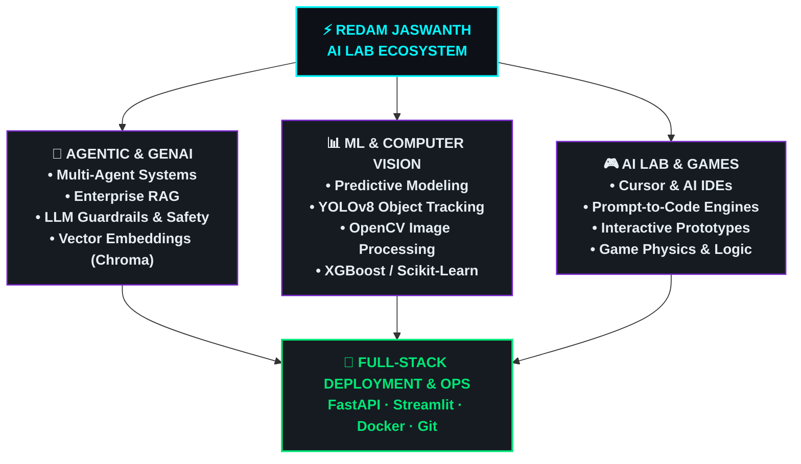

<div align="center">

<!-- HEADER BANNER -->


<br>

<!-- TYPING ANIMATION -->


<br><br>

<!-- QUICK CONNECT & SOCIAL BADGES -->
<a href="https://www.linkedin.com/in/redamjaswanth/" target="_blank">
  
</a>
<a href="mailto:jaswanthredam@gmail.com">
  
</a>
<a href="https://github.com/RedamJaswanth">
  
</a>
<a href="https://github.com/RedamJaswanth?tab=repositories">
  
</a>

<br><br>

<!-- TELEMETRY / VISITORS -->


</div>

---

<!-- TERMINAL HUD & BIO -->
<div align="center">

```text
╔════════════════════════════════════════════════════════════════════════════════════════╗
║                             ⚡ AUTONOMOUS AI LAB // TERMINAL HUD                       ║
╠════════════════════════════════════════════════════════════════════════════════════════╣
║                                                                                        ║
║  ▶ USER IDENTIFIER  : REDAM JASWANTH                                                  ║
║  ▶ SPECIALIZATION   : AI / ML Engineer & Agentic Systems Builder                       ║
║  ▶ EDUCATION        : Master of Computer Applications (MCA)                            ║
║  ▶ CORE MISSION     : Engineer resilient AI systems from prompt to production         ║
║  ▶ WORKFLOW LOOP    : PROMPT ➔ ARCHITECT ➔ CODE ➔ TRAIN ➔ BENCHMARK ➔ SHIP            ║
║  ▶ ACTIVE NODES     : Multi-Agent Swarms · Enterprise RAG · Computer Vision · AI Games ║
║                                                                                        ║
╚════════════════════════════════════════════════════════════════════════════════════════╝
```

</div>

<br>

<h2 align="center">💡 Who I Am & What I Build</h2>

I am an **AI & Machine Learning Engineer** dedicated to engineering intelligent, scalable, and autonomous systems that bridge state-of-the-art AI research with practical software solutions.

I specialize in **Generative AI, Retrieval-Augmented Generation (RAG), Autonomous Multi-Agent Architectures, Computer Vision, and Deep Learning**. Beyond standard machine learning pipelines, I actively push the frontier of **Prompt-Driven Software Engineering and AI-assisted Game Development**, utilizing next-generation AI environments like Cursor and Antigravity to turn abstract ideas into production-ready software.

> *"I don't just study AI algorithms — I design, stress-test, and deploy systems that solve complex problems."*

<br>

---

<!-- ARCHITECTURE FLOW DIAGRAM (CENTERED VIA MERMAID) -->
<div align="center">

<h3>🏛️ System Architecture & Workflow Pipeline</h3>



</div>

---

<!-- MASTER TECH STACK -->
<div align="center">

<h2>🛠️ Tech Stack & Engineering Arsenal</h2>

<br>

### 💻 Languages & Core
<p align="center">
  
  <br><br>
  
</p>

### 🧠 AI, Machine Learning & Deep Learning
<p align="center">
  
  <br><br>
  
  
  
  
  
  
</p>

### ⚡ Generative AI, LLMs & Agentic Systems
<p align="center">
  
  
  
  
  
  
  
</p>

### 🗄️ Vector Databases & Knowledge Storage
<p align="center">
  
  
  
</p>

### 📊 Data Science, Analytics & BI
<p align="center">
  
  
  
  
</p>

### 🛠️ Backend, Deployment & Developer Tooling
<p align="center">
  
  <br><br>
  
  
  
  
</p>

</div>

---

<!-- FEATURED PROJECTS SHOWCASE -->
<div align="center">

<h2>🚀 Featured AI Engineering Projects</h2>

</div>

<br>

### 🤖 01. [Multi-Agent-AI-System](https://github.com/RedamJaswanth/Multi-Agent-AI-System)
> **Autonomous Multi-Agent Collaboration & Distributed Task Execution Framework**
- Architected a coordinated multi-agent environment where specialized AI agents plan, delegate, execute, and cross-validate complex programming and analytical workflows.
- Implemented autonomous tool-calling, inter-agent messaging channels, consensus validation loops, and dynamic error recovery.
- **Technologies:** `Python` · `Agentic AI` · `LLMs` · `Task Orchestration` · `Prompt Architecture`

---

### 🔎 02. [Advanced_PDF_RAG_Assistant](https://github.com/RedamJaswanth/Advanced_PDF_RAG_Assistant)
> **Production-Grade Context-Aware Retrieval-Augmented Generation Engine**
- Built an intelligent document interrogation system processing dense multi-page PDFs with high retrieval accuracy and minimal hallucination.
- Features semantic document chunking, ChromaDB vector indexing, MMR re-ranking, and Google Gemini LLM synthesis.
- **Technologies:** `Python` · `LangChain` · `Google Gemini API` · `ChromaDB` · `Streamlit`

---

### 🛡️ 03. [Cybersecurity-Threat-Intelligence-Tableau-Dashboard](https://github.com/RedamJaswanth/Cybersecurity-Threat-Intelligence-Tableau-Dashboard)
> **Interactive SOC Operations & Real-Time MITRE ATT&CK Matrix Analytics**
- Created an enterprise Security Operations Center (SOC) dashboard tracking global cyber threats, attacker dwell time, CVSS severity distributions, and incident response velocity.
- Features automated data pipelines, tactical attack vector matrices, CISO executive summaries, and dynamic geo-threat intelligence.
- **Technologies:** `Tableau` · `Cybersecurity Threat Intel` · `Python` · `MITRE ATT&CK` · `Data Analytics`

---

### 🛡️ 04. [LLM-Guardrails_Workshop](https://github.com/RedamJaswanth/LLM-Guardrails_Workshop)
> **Enterprise AI Safety Protocols, Validation Boundaries & Prompt Security**
- Engineered defense layers against prompt injections, adversarial jailbreaks, PII leakage, and non-deterministic hallucinations.
- Enforces strict input validation, regex/semantic guard filtering, structured JSON schema outputs, and confidence threshold gates.
- **Technologies:** `Python` · `LLM Guardrails` · `AI Security` · `Prompt Defense` · `Structured Outputs`

---

### 🚗 05. [Vehicle_Number_Plate_Detection](https://github.com/RedamJaswanth/Vehicle_Number_Plate_Detection) & [YOLO-Object-Detection](https://github.com/RedamJaswanth/YOLO-Object-Detection)
> **Deep Learning Computer Vision Pipeline with Real-Time Bounding Box Tracking & OCR**
- Deployed state-of-the-art YOLOv8 object detection paired with EasyOCR image pre-processing (bilateral filtering, adaptive thresholding) for high-accuracy license plate character recognition.
- **Technologies:** `Python` · `YOLOv8` · `OpenCV` · `EasyOCR` · `Deep Learning`

---

### 💳 06. [Fraud-Detection-Risk-Scoring](https://github.com/RedamJaswanth/Fraud-Detection-Risk-Scoring)
> **High-Precision Financial Anomaly Classifier (99.95% Accuracy)**
- Implemented an industrial fraud detection pipeline addressing severe class imbalance using SMOTE and hyperparameter-tuned XGBoost.
- Features custom probability calibration, dynamic risk scoring tiers (Low, Medium, High, Critical), and 97.61% ROC-AUC.
- **Technologies:** `Scikit-Learn` · `XGBoost` · `SMOTE` · `Pandas` · `Predictive Modeling`

---

### 📄 07. [Resume_Analyzer_App](https://github.com/RedamJaswanth/Resume_Analyzer_App)
> **AI-Powered ATS Matching, Semantic Skill Gap Analysis & Career Intelligence**
- Automated resume parsing system extracting candidate skills, experience, and certifications, matching them against job descriptions with semantic similarity scoring.
- **Technologies:** `Python` · `NLP` · `Streamlit` · `Generative AI` · `Text Analytics`

<br>

<div align="center">
  <a href="https://github.com/RedamJaswanth?tab=repositories">
    
  </a>
</div>

<br>

---

<!-- AI GAME LAB SECTION -->
<div align="center">

<h2>🎮 AI Game Dev Lab & Prompt-to-Play Arcade</h2>

<br>


<br><br>

```text
┌────────────────────────────────────────────────────────────────────────┐
│                        🕹️ PROMPT ➔ CODE ➔ GAMEPLAY                     │
├────────────────────────────────────────────────────────────────────────┤
│                                                                        │
│   💡 CONCEPTUAL IDEA                                                   │
│        ↓                                                               │
│   📝 NATURAL LANGUAGE PROMPT ARCHITECTURE                              │
│        ↓                                                               │
│   🤖 AI CODING ASSISTANT & CO-PILOT (Cursor / IDE)                     │
│        ↓                                                               │
│   ⚡ CODE SYNTHESIS (Physics, State Machine, Canvas, Mechanics)        │
│        ↓                                                               │
│   🧪 RAPID PLAYTESTING & ITERATIVE TUNING                              │
│        ↓                                                               │
│   🎮 PLAYABLE INTERACTIVE EXPERIENCE                                  │
│                                                                        │
└────────────────────────────────────────────────────────────────────────┘
```

</div>

> **Philosophy:** Building games is the ultimate test of software engineering, dynamic state management, user feedback loops, and creative logic. By leveraging AI-assisted coding, I translate mechanics from natural language into responsive gameplay.

---

<!-- GITHUB COMMAND CENTER -->
<div align="center">

<h2>📈 GitHub Telemetry & Stats Hub</h2>

<br>

<!-- GITHUB STATS & TOP LANGS -->
<a href="https://github.com/RedamJaswanth">
  
</a>
<a href="https://github.com/RedamJaswanth">
  
</a>

<br><br>

<!-- STREAK STATS -->
<a href="https://github.com/RedamJaswanth">
  
</a>

</div>

---

<!-- CONNECT & COLLABORATE -->
<div align="center">

<h2>🤝 Let's Connect & Collaborate</h2>

<br>


<br><br>

<a href="https://www.linkedin.com/in/redamjaswanth/" target="_blank">
  
</a>
&nbsp;&nbsp;
<a href="mailto:jaswanthredam@gmail.com">
  
</a>
&nbsp;&nbsp;
<a href="https://github.com/RedamJaswanth">
  
</a>

<br><br>

```text
┌────────────────────────────────────────────────────────────────────────┐
│  "The best way to predict the future is to architect the autonomous    │
│   intelligent systems that build it."                                  │
└────────────────────────────────────────────────────────────────────────┘
```

<br>

<!-- FOOTER BANNER -->


<p align="center">
  ⚡ <b>ENGINEERED BY REDAM JASWANTH</b> ⚡<br>
  <sub>Powered by Python · Multi-Agent AI · Large Language Models · Curiosity</sub>
</p>

</div>
